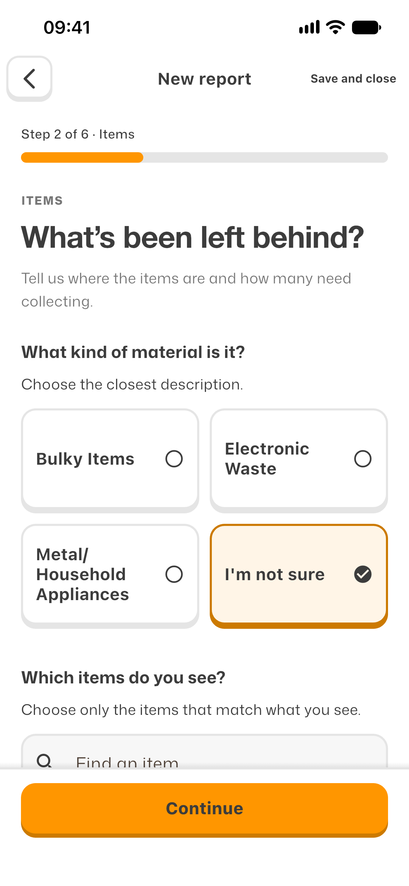
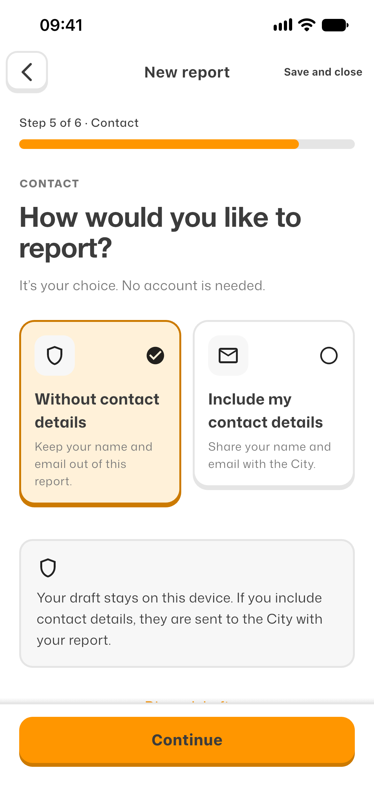
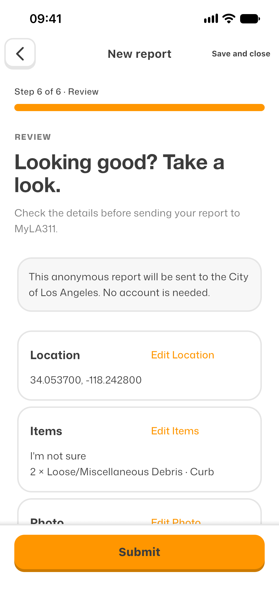

# MyLA311

### City services, in your pocket.

MyLA311 is a Flutter mobile app for Los Angeles city services and reports.
It guides residents from finding a location to reviewing a report, with room to
save progress and return later.

**Product design and engineering by [regisksc](https://github.com/regisksc).**

*Actual native app captures with synthetic example data. Screenshots demonstrate
the interface, not acceptance of these examples by the City.*

## The problem

City reporting spans different services, questions and follow-up needs.
MyLA311 provides a shared mobile interface for service discovery, guided report
preparation and saved records.

The design centers the resident's next decision: choose the service, explain the
problem, check the details and understand what happens next.

## One report, six clear steps

**Location → Items → Photos → Details → Contact → Review**

Search for an address or use GPS, describe the debris, and add optional photos
and a description. Choose anonymous or named contact, then review the report
before the explicit City submission action. A draft retains its saved progress;
starting over asks before replacing it.

  
  
  

*Describe the problem. Choose how to be contacted. Review before sending.
Open an image to inspect the full-size native screen.*

## Design that makes the next step visible

### Orange carries the action

A bright orange Home introduces the app, while quieter white surfaces make the
forms easier to scan. Mona Sans, rounded cards and raised controls carry the same
visual language through service discovery, reporting, Help and saved Reports.
Contextual actions keep navigation focused without a persistent bottom tab bar.

### Feedback feels physical

Controls visibly depress and recover. Submission delivery uses an envelope and
City Hall motion sequence, with a reduced-motion alternative. Touch targets,
keyboard-aware actions and visible validation feedback are part of the journey,
alongside the visual styling.

### Recovery belongs in the flow

A failed catalog read offers Retry. Draft replacement requires confirmation.
Interrupted sends are kept distinct from confirmed Receipts so an uncertain
response does not invite a duplicate submission. Existing Reports and Service
Request numbers are preserved when preview data is cleared.

## From interface reference to native app

The work connects a [canonical interactive design](design-prototype/reports-prototype-buttons-v2.html)
to native Flutter screens and a documented Portal client. The City's guest-session
transport, question loading, photo payload and submission contract are recorded in
the [Portal API reference](docs/portal-api.md).

The design was checked screen by screen at **390 × 844** and **375 × 812**.
Comparisons drove corrections to typography, spacing, card heights, headers and
validation visibility. Native controls, map rendering and truthful submission
copy retain disclosed differences from the browser prototype.

## What is connected today

**City catalog:** the shipped native app successfully reads current service names
and groups from the City's guest portal.

**Illegal dumping:** the native submission client supports location, required
debris answers, optional photos and description, contact choice, draft recovery
and saved Receipts. Historical native-send provenance is incomplete, so a full
native-to-City Submission remains **unverified**. No new City request was sent
for this showcase; acceptance and delivery visuals use controlled test responses.

**Other services and account:** these are clearly marked local previews.
They do not authenticate residents to the City or submit other request types.
Preview lookup IDs identify local records, and email-update choices save only a
local preference. Unverified access requirements do not offer a new preview
action.

Native checks exercised photo-library selection, save/resume/removal, actual OS
keyboards, validation feedback and motion at both sizes. Camera hardware and
several permission/storage failure conditions have automated flow evidence
rather than physical-device verification. These are engineering checks, not
claims of resident adoption or measured service improvements.

## Explore the project

- [Run the Flutter app and its checks](reports/README.md)
- [Explore the interface reference](design-prototype/reports-prototype-buttons-v2.html)
- [Read the reverse-engineered Portal API](docs/portal-api.md)
- [Understand reports, receipts and local previews](GLOSSARY.md)
- [Browse the authored submission animation](animation/)

Flutter commands run from `reports/`. Developer tools follow the
`REPORTS_DEV_MODE` build flag: enabled by default in debug, disabled in profile
and release. Override with `--dart-define=REPORTS_DEV_MODE=false` or `true`.
The HTML reference exposes its developer playground with `?dev=1`.

Project guidance lives in [AGENTS.md](AGENTS.md) and the [glossary](GLOSSARY.md).
The project documentation records the implementation decisions
and implementation records. See the [agent workflow](docs/agents/issue-tracker.md)
for local issue tracking and the [Portal API reference](docs/portal-api.md)
for the submission contract.
