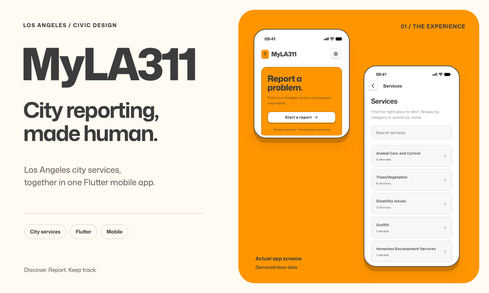
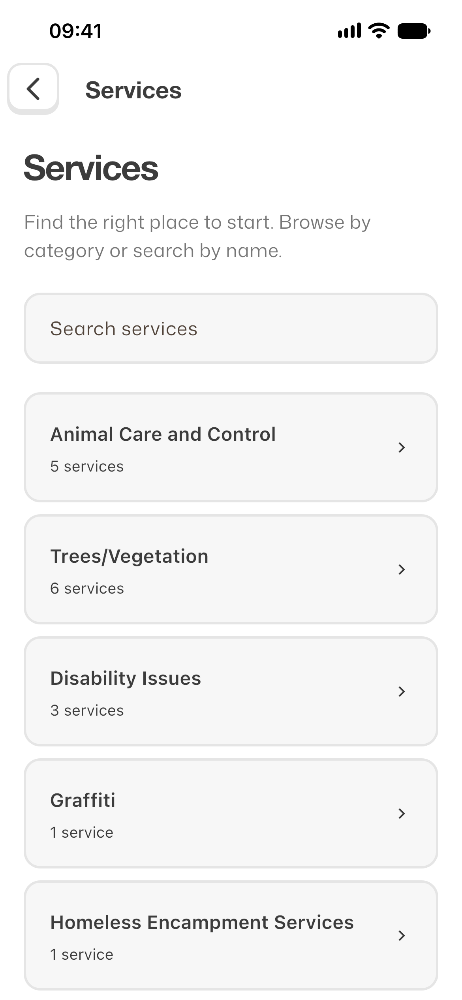
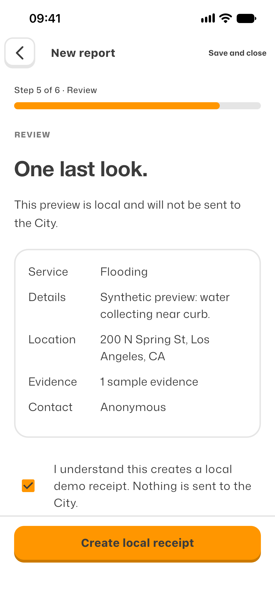
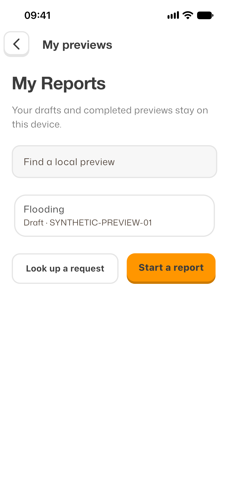

# MyLA311

### City services, in your pocket.

MyLA311 is a Flutter mobile app for Los Angeles city services. Discover the right
service, prepare a report, save your progress and find your records again, all
through one consistent mobile experience.

**Product design and engineering by [regisksc](https://github.com/regisksc).**

*Actual native app captures with synthetic example data. Screenshots demonstrate
the interface, not acceptance of these examples by the City.*

## One place for the next step

City reporting spans different services, questions and follow-up needs. MyLA311
brings service discovery, guided report preparation and saved records into a
shared interface, with contextual access to account tools and Help.

The experience centers the resident's next decision: find the service, explain
the problem, check the details and understand what happens next.

## Discover. Prepare. Keep track.

**Browse services → Prepare a report → Review → Save and follow up**

Browse service groups or search for a request type. Each journey presents the
relevant information, location, evidence and contact choices before review.
Saved Reports and local preview records retain their context, so returning to a
draft does not mean starting from scratch. Help and account tools are available
where they are needed.

  
  
  

*Find a service. Review the details. Return to saved work.
Open an image to inspect the full-size native screen.*

## Design that makes the next step visible

### Orange carries the action

A bright orange Home introduces the app, while quieter white surfaces make the
forms easier to scan. Mona Sans, rounded cards and raised controls carry the same
visual language through service discovery, reporting, Help and saved Reports.
Contextual actions keep navigation focused without a persistent bottom tab bar.

### Feedback feels physical

Controls visibly depress and recover. Submission delivery uses an envelope and
City Hall motion sequence, with a reduced-motion alternative. Touch targets,
keyboard-aware actions and visible validation feedback are part of the journey,
alongside the visual styling.

### Recovery belongs in the flow

A failed catalog read offers Retry. Draft replacement requires confirmation.
Interrupted sends are kept distinct from confirmed Receipts so an uncertain
response does not invite a duplicate submission. Existing Reports and Service
Request numbers are preserved when preview data is cleared.

## A shared mobile design, built in Flutter

The work connects a [canonical interactive design](design-prototype/reports-prototype-buttons-v2.html)
to Flutter screens, shared Dart features and a documented Portal client. The City's guest-session
transport, question loading, photo payload and submission contract are recorded in
the [Portal API reference](docs/portal-api.md).

The design was checked screen by screen at **390 × 844** and **375 × 812**.
Comparisons drove corrections to typography, spacing, card heights, headers and
validation visibility. Native controls, map rendering and truthful submission
copy retain disclosed differences from the browser prototype.

## Integration status

**City catalog:** the shipped native app successfully reads current service names
and groups from the City's guest portal.

**Illegal dumping:** this service's submission client supports location, required
debris answers, optional photos and description, contact choice, draft recovery
and saved Receipts. Historical native-send provenance is incomplete, so a full
native-to-City Submission remains **unverified**. No new City request was sent
for this showcase; acceptance and delivery visuals use controlled test responses.

**Other services and account:** these are clearly marked local previews.
They do not authenticate residents to the City or submit other request types.
Preview lookup IDs identify local records, and email-update choices save only a
local preference. Unverified access requirements do not offer a new preview
action.

Native checks exercised photo-library selection, save/resume/removal, actual OS
keyboards, validation feedback and motion at both sizes. Camera hardware and
several permission/storage failure conditions have automated flow evidence
rather than physical-device verification. These are engineering checks, not
claims of resident adoption or measured service improvements.

## Explore the project

- [Run the Flutter app and its checks](reports/README.md)
- [Explore the interface reference](design-prototype/reports-prototype-buttons-v2.html)
- [Read the reverse-engineered Portal API](docs/portal-api.md)
- [Understand reports, receipts and local previews](GLOSSARY.md)
- [Browse the authored submission animation](animation/)

Flutter commands run from `reports/`. Developer tools follow the
`REPORTS_DEV_MODE` build flag: enabled by default in debug, disabled in profile
and release. Override with `--dart-define=REPORTS_DEV_MODE=false` or `true`.
The HTML reference exposes its developer playground with `?dev=1`.

Project terminology lives in the [glossary](GLOSSARY.md). See the
[Portal API reference](docs/portal-api.md) for the current submission contract.
